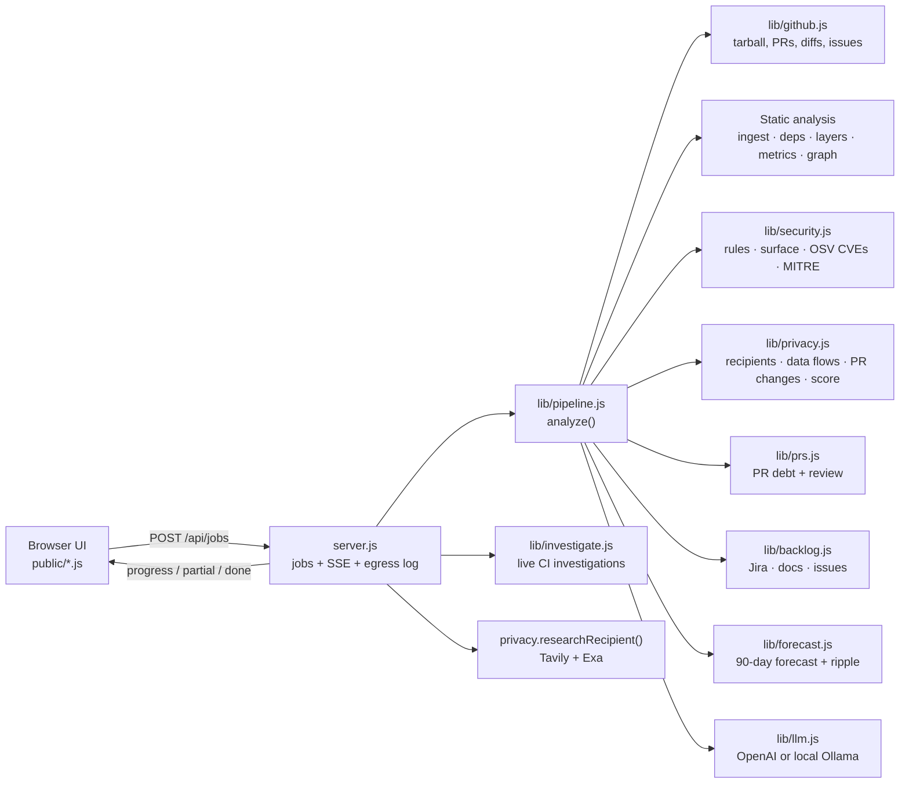
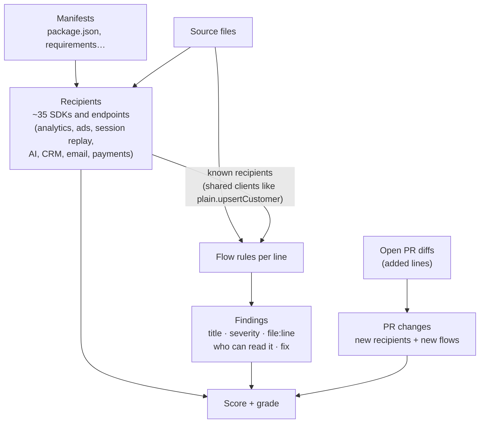

# Narc architecture

Narc is a single Node.js process (no dependencies, Node 18+) that serves a vanilla-JS UI and runs analyses as background jobs. One analysis = one GitHub repo, read once, then examined by a set of static analysers and optional AI agents. Results stream to the browser over Server-Sent Events.

## Request lifecycle

1. **`POST /api/jobs`** with `{ repoUrl, localAi, keys… }` creates a job (in memory, evicted after 6 h) and starts `analyze()`.
2. **`GET /api/jobs/:id/stream`** (SSE) replays the job's events and follows it: `progress` (stage messages), `agent` (AI agent state), `partial` (a usable result before AI finishes) and `done` / `error`.
3. The UI renders the `partial` result immediately, then re-renders on `done`. Every tab reads from the same result object (`S.data`).
4. Follow-up endpoints work on a finished job:

| Endpoint | Purpose |
|---|---|
| `POST /api/deep-dive` | AI reads a layer's hotspot files and explains them |
| `POST /api/investigate` | Live CI investigations for the analysed repo (cached per job, `refresh` re-reads GitHub) |
| `POST /api/privacy/research` | Tavily + Exa dossier on one data recipient (cached 7 days) |
| `GET /api/egress?jobId=` | Every outbound request Narc made since the job started |
| `GET /api/demo`, `GET /api/incidents` | Built-in demo data (synthetic) |

## The pipeline (`lib/pipeline.js`)

Phases run as concurrently as their inputs allow.

| Phase | Work | Network |
|---|---|---|
| 1. Fetch | Repo metadata; the default branch as **one tarball** (not per-file API calls); open/closed PRs and up to N open-PR diffs; issues; Jira | GitHub, Jira |
| 2. Parse | `ingest.js` unpacks and filters files; `deps.js` extracts and resolves imports for ~12 languages; `layers.js` classifies each file into a layer; `metrics.js` measures it | none |
| 3. Graph | `graph.js`: layer and module graphs, Tarjan SCC cycles, layering violations, hotspots, static debt scores | none |
| 4. Security | `security.js`: ~30 line rules mapped to CWE + MITRE ATT&CK/ATLAS, committed key files, attack surface (routes + auth), dependency CVEs from OSV.dev | OSV.dev |
| 5. Privacy | `privacy.js`: see below | none |
| 6. PRs | `prs.js`: 16 debt heuristics per diff, PR security findings, merge probability from the repo's real merge history | none |
| 7. Backlog | `backlog.js`: tasks from Jira, docs, CSV, issues → layers, accrual or paydown | none (AI optional) |
| 8. Forecast | `forecast.js`: per-layer 90-day series; ripple of inherited debt through the dependency graph (BFS, decaying) | none |
| 9. AI agents | Layer refinement, PR reviews, backlog mapping, threat model, briefing and narratives | OpenAI or local Ollama |
| 10. History | Snapshot saved; diff against the previous run of the same repo for the Timeline | none |

Without an AI key the pipeline is fully heuristic and still produces every tab. AI results are cached on disk by a hash of (model, prompt), so re-runs are fast and send nothing new.

## Privacy debt (`lib/privacy.js`)

Pure static analysis over the files and diffs already in memory. No AI, no network.

**Recipients.** Each catalogue entry has a package pattern, a code pattern (hostnames, globals, SDK calls), a category with a risk weight (ads, session replay and enrichment highest; payments and messaging lowest), the company's website for research, and what it typically collects.

**Personal data.** Twelve kinds (email, phone, name, address, location, IP, birth date, government ID, card, health, password, gender/ethnicity), matched on identifiers, each with a sensitivity weight.

**Flow rules.** A finding needs both a sink and personal data *in that call's own arguments* (the call line plus the lines until its brackets close), so neighbouring lines don't leak into each other:

| Rule | Sink | Example |
|---|---|---|
| `pii-to-third-party` | tracking calls (`track`, `identify`, `people.set`…) or a vendor client call in a file that uses that vendor | `plain.upsertCustomer({ email: user.email })` |
| `pii-to-ai` | LLM calls / prompt construction in a file that uses an AI SDK | a prompt template containing `diagnosis` |
| `pii-in-logs` | `console.*`, `logger.*`, `print`… with personal data in **code**, not in the message text (string literals are blanked, `${}` kept) | `` console.log(`user ${user.email}`) `` |
| `pii-in-browser` | `localStorage` / `sessionStorage` / cookies | `localStorage.setItem("userEmail", email)` |
| `pii-in-url` | personal data in a query string | `?email=${email}` |
| `replay-unmasked` | session replay or error tracking set to capture everything | `maskAllInputs: false`, `sendDefaultPii: true` |
| `sensitive-unencrypted` | health, financial or ID columns in a model/schema file with no sign of encryption | `ssn = Column(String)` |

**PR changes.** Added lines in manifests that pull in a recipient package, added code that starts talking to a new recipient, and the same flow rules on added code.

**Score.** `100 − min(55, flow points) − min(30, recipient points) − min(15, PR points)`, where flow points grow steeply with severity. Grades: A Excellent (90+), B Good (75+), C Fair (60+), D Poor (40+), F Failing.

**Dossiers** (`researchRecipient`). Tavily (advanced search with an answer) and Exa (highlights) are queried with the company name and website, restricted to the company's own domain first and the open web only if that's empty. `policyFlags()` reads the answer sentence by sentence and returns yes / no / not stated for *sells data*, *ads* and *AI training*: a sentence with a negation is "no", and one that's unsure ("doesn't say whether…") is skipped, so absence never becomes "yes".

## Local AI and the egress log

**Local AI.** `llm.js` speaks the OpenAI Chat Completions API to any base URL. With `localAi` (Settings switch or `NARC_LOCAL_AI=1`) the server points it at Ollama (`http://127.0.0.1:11434/v1`, `qwen2.5:7b` by default), so every prompt (code, diffs, PR text) stays on the machine.

**Egress log.** `server.js` wraps `globalThis.fetch` once at start-up, so every module's outbound request is recorded without changes elsewhere: time, host, method, bytes sent, who it was (GitHub, OSV.dev, Tavily, Exa, OpenAI, Local AI, status pages, registries), why, and for searches the exact query text. `GET /api/egress` returns the requests since a job started, and the Privacy tab's **What Narc sent** groups them. When OpenAI appears, it says how many KB of code went out; when AI answers came from cache, it says so instead of claiming nothing would ever be sent.

## Live CI investigations (`lib/investigate.js`)

For the analysed repo, Narc reads recent workflow runs on the default branch (push and schedule events) and the latest runs of open PRs. A **break** is a failed run whose previous run of the same workflow passed. Each break or failing PR becomes a case with three suspects scored from clues that link to real evidence:

* **Bad change**: commits between the last green and first red run (compare API) or the PR diff; annotations or job logs that name a changed file; other workflows passing on the same commit.
* **Vendor outage**: infrastructure error signatures, the same commit passing on a re-run, unrelated failures clustered in time, and incidents from GitHub/npm/PyPI status pages at that moment.
* **Attack**: hidden instructions aimed at AI agents in PR text, workflow edits by outside contributors, `pull_request_target` with a head checkout, secrets sent to the network, hard-coded keys, and new packages that are missing from or barely used on npm/PyPI. Each clue carries MITRE ATT&CK / ATLAS techniques.

The **MITRE map** merges these techniques with the security scan's, and **Blast radius** walks the import graph from a case's changed layers to everything that depends on them.

## Front end (`public/`)

* `app.js`: shell, routing between tabs, analysis stream, Architecture graph (Cytoscape), Overview, Security, PRs, Backlog, Hotspots, People, Timeline, Report. Exposes shared helpers as `window.NarcUI`.
* `incidents.js`: Investigations, MITRE map, Blast radius.
* `privacy.js`: Privacy tab (score, Telescreen SVG, dossiers, flows, PR watch, inventory, What Narc sent). Researches the top recipients automatically when the tab opens.
* `styles.css`: one design system with light and dark themes; each feature's styles are namespaced (`.inc-*`, `.pv-*`).

No build step: the server serves these files as-is.

## Data and storage

| What | Where | Lifetime |
|---|---|---|
| Jobs and results | server memory | 6 hours, lost on restart |
| AI answers, search results, OSV lookups | `.narc-cache/` (git-ignored) | until deleted; searches 12 h to 7 days |
| Snapshots for the Timeline | `.narc-cache/` | until deleted |
| Keys | `.env` (git-ignored) or browser localStorage | yours |
| Demo incidents | `data/incidents.json` (synthetic logs) | in the repo |

## Limits

* Detection is regex- and pattern-based. It finds leads quickly across many languages, but it can miss flows that go through several functions, and it can flag a variable name that only looks personal.
* The recipient catalogue covers common SDKs; a vendor called through raw HTTP to an unknown host isn't named.
* Local AI is slower than a hosted model (a small repo takes about two minutes on a laptop) and its reviews are less detailed.
* Jobs live in memory, so restarting the server loses open analyses (snapshots and caches survive).
